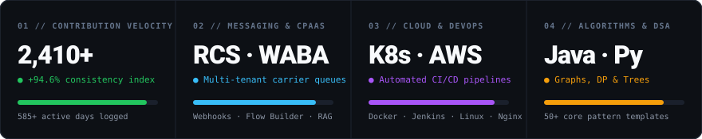

<div align="center">



<br/>

<a href="https://git.io/typing-svg">
  
</a>

<p align="center">
  <a href="https://www.linkedin.com/in/sankalp-dev-1918a424b/" target="_blank">
    
  </a>
  <a href="mailto:thakursankalp974@gmail.com">
    
  </a>
  
</p>



</div>

---

### `// 01. BACKEND ARCHITECTURE & PRODUCTION SYSTEMS`

```yaml
engineer:
  name: "Sankalp Dev"
  role: "Backend & Distributed Systems Engineer @ Lemin AI"
  previous: "Co-Founder @ Coders Crux"
  focus: "Event-Driven Microservices, High-Concurrency APIs & Cloud Infrastructure"

production_systems:
  event_streaming_&_messaging:
    - "Apache Kafka producer/consumer pipelines for high-volume RCS & WhatsApp (WABA) dispatches"
    - "Idempotent webhook ingestion, Dead-Letter Queues (DLQ), and Redis token-bucket rate limiting"
    - "Real-time delivery receipt reconciliation, smart channel failover & P2A/A2P billing windows"
  api_&_database_engineering:
    - "Low-latency REST & WebSocket APIs built with Python (Django, FastAPI, Flask) and Node.js"
    - "ACID-compliant prepaid wallet ledgers with pessimistic locking and in-flight balance reservation"
    - "Multi-tenant PostgreSQL & MySQL query optimization, composite indexing & Redis caching layers"
  cloud_&_devops_infrastructure:
    - "Containerized microservice deployments on Kubernetes & Docker with Nginx reverse proxies"
    - "Automated CI/CD pipelines via GitHub Actions, AWS cloud infrastructure & Linux observability"
```

---

### `// 02. BACKEND & INFRASTRUCTURE STACK`

<div align="center">

| Layer | Technologies & Production Tooling |
| :--- | :--- |
| **Backend & APIs** |        |
| **Streaming & Queues** |     |
| **Databases & Storage** |      |
| **Cloud & DevOps** |        |

<br/>


</div>

---

### `// 03. LIVE GITHUB TELEMETRY & COMMIT VELOCITY`

<div align="center">


<p align="center">
  
  
  
</p>


</div>
