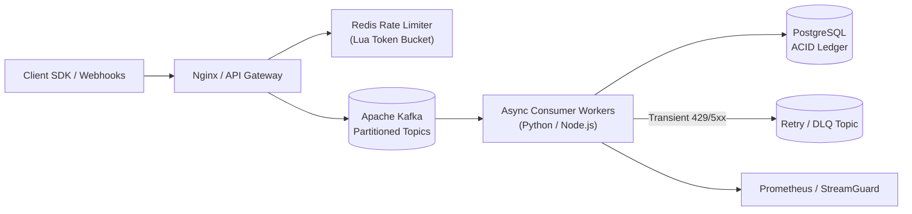

 

  
  
  

---

### About Me

I'm a **Backend & Distributed Systems Engineer** currently building multi-tenant **RCS Business Messaging (RBM)** & **WhatsApp Business API** infrastructure at **Lemin AI**, and previously **Co-Founder at Coders Crux**.

My day-to-day work focuses on:
- **Event-Driven Messaging Pipelines:** Designing asynchronous producer/consumer architectures with **Apache Kafka**, Dead-Letter Queues (DLQ), exponential backoff retries, and idempotent webhook ingestion.
- **Concurrency-Safe Backend Services:** Writing low-latency APIs in **Python (FastAPI, Django, Flask)** and **Node.js (Express)** backed by **PostgreSQL** (`FOR UPDATE` locking, composite indexing) and **Redis** (sliding-window rate limiting & caching).
- **Cloud & DevOps Reliability:** Containerizing services with **Docker**, orchestrating workloads on **Kubernetes (HPA & ServiceMonitors)**, configuring **Nginx**, and automating builds via **GitHub Actions** on **AWS**.

---

### Featured Backend & Infrastructure Projects

| Repository | Architecture & Engineering Focus | Core Stack |
| :--- | :--- | :--- |
| [**`pulse-mq`**](https://github.com/sankalp3153/pulse-mq) | Event-driven messaging & webhook dispatch gateway featuring atomic Redis Lua token-bucket rate limiting, constant-time HMAC-SHA256 webhook verification, RCS→WhatsApp failover, and Kafka DLQ retries. | `Python` `FastAPI` `Kafka` `Redis` `K8s` |
| [**`ledger-core`**](https://github.com/sankalp3153/ledger-core) | Concurrency-safe multi-tenant prepaid wallet & two-phase reservation ledger (`reserve → settle / release`) using integer minor units, idempotency keys, and PostgreSQL `SELECT ... FOR UPDATE` row locking. | `Node.js` `JavaScript` `PostgreSQL` `Redis` `Docker` |
| [**`stream-guard`**](https://github.com/sankalp3153/stream-guard) | Lightweight Prometheus exposition exporter & SLA lag evaluator for Kafka consumer groups with cooldown alert deduplication and Kubernetes `ServiceMonitor` manifests. | `Python` `Kafka` `Prometheus` `Kubernetes` |
| [**`DSA`**](https://github.com/sankalp3153/DSA) | Tested distributed systems primitives (`ConsistentHashRing`, `TokenBucketLimiter`, `LRUCache`) alongside core graph, DP, and sliding-window algorithms with CI test suites. | `Python` `JavaScript` `GitHub Actions` |
| [**`crx_db`**](https://github.com/sankalp3153/crx_db) | Normalized PostgreSQL relational schema, ERD documentation, and query design powering Coders Crux hackathons, quizzes, and submissions. | `PostgreSQL` `SQL` `Schema Design` |
| [**`Chat_Analysis`**](https://github.com/sankalp3153/Chat_Analysis) | Messaging log parser and NLP analytics pipeline extracting user engagement patterns, temporal heatmaps, and content telemetry. | `Python` `NLP` `Data Analytics` |

---

### Systems Architecture Pattern

---

### Technical Stack

| Domain | Technologies |
| :--- | :--- |
| **Languages & Runtimes** |      |
| **Backend & APIs** |      |
| **Streaming & Data** |       |
| **Cloud & DevOps** |        |

 

---

### GitHub Activity

  
  
  

